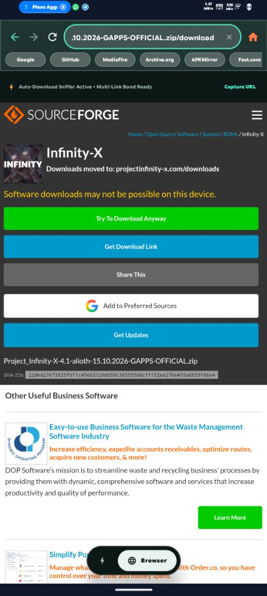

<div align="center">
  
  <h1>Plexo Android ⚡</h1>
  <p><b>Multi-Link Aggregation Downloader for Android</b><br/><i>UI Design & Art Direction by <a href="https://github.com/vitalityuser">@vitalityuser</a></i></p>
</div>

An open-source Android download manager that combines **Wi-Fi + Mobile Cellular (5G/4G)** into a single bonded high-speed pipeline. Features automatic download sniffing from Chrome and a built-in browser, wrapped in a frosted glass sage aesthetic.

---

## 📱 Screenshots

<div align="center">
  <table>
    <tr>
      <td align="center" width="33%">
        <b>⚡ Real-Time Bonded Download</b><br/><br/>
        
      </td>
      <td align="center" width="33%">
        <b>🌐 Built-In Browser Sniffer</b><br/><br/>
        
      </td>
      <td align="center" width="33%">
        <b>🛠️ Quick Setup & Bonding Guide</b><br/><br/>
        
      </td>
    </tr>
  </table>
</div>

---

## 🚀 Key Features

- **⚡ Simultaneous Wi-Fi & Cellular Bonding**:
  Uses Android's `ConnectivityManager.requestNetwork` to force both Wi-Fi and Mobile Data to stay active simultaneously, routing chunks through per-socket `OkHttpClient` bindings.
- **🎯 Auto-Detect Downloads from Chrome & Any Browser**:
  Share any link to Plexo or tap direct download links (`.apk`, `.zip`, `.rar`, `.7z`, `.iso`, `.mp4`, `.bin`, `.exe`, etc.) to instantly begin bonded downloading.
- **📋 Smart Clipboard Sniffer**:
  Automatically detects copied file links from your clipboard when switching back to Plexo.
- **🌐 Dedicated In-App Plexo Browser**:
  Built-in browser with 1-tap download interception (`DownloadListener`), quick bookmark shortcuts, and automatic switching to the real-time speedometers.
- **🎨 Frosted Sage Glassmorphism UI**:
  Signature translucent glass cards, radial speed dials, live canvas telemetry waveforms, and a floating dark pill bottom navigation bar.
- **🛡️ Background Resiliency**:
  Runs via an Android `ForegroundService` with WakeLock protection so multi-stream downloads continue at maximum speed even when your screen is locked.

---

## ⚡ Quick Setup Guide (How to Bond Networks)

1. **Enable Mobile Data Always Active**:
   - Go to Android **Settings > Developer Options**.
   - Turn **ON** **"Mobile data always active"** (allows Android to keep Cellular alive even while connected to Wi-Fi).
2. **Turn On Both Connections**:
   - Enable both **Wi-Fi** and **Mobile Data**. The top badge in Plexo will illuminate **`⚡ BONDED`**.
3. **Download from Chrome or Built-in Browser**:
   - In Chrome, tap **Share > Plexo**, copy any download URL, or browse websites in Plexo's **Browser** tab.
4. **Set Battery to Unrestricted**:
   - In App Info > Battery, select **Unrestricted** to prevent the OS from pausing background streams.

---

## 🛠️ Build & Install

### Download Pre-Built APK
Download the latest versioned release directly:

[](https://github.com/VitalityUser/plexo-android/releases/download/v1.0.0/Plexo-Android-v1.0.0.apk)

Or browse all versions in the [Releases](https://github.com/VitalityUser/plexo-android/releases) section.

### Building from Source
```powershell
# Clone the repository
git clone https://github.com/vitalityuser/plexo-android.git
cd plexo-android

# Build APK (automatically outputs version-named APK)
./gradlew assembleDebug
```
The compiled APK will be located at `app/build/outputs/apk/debug/Plexo-Android-v1.0.0.apk`.

### Installing via ADB
```powershell
adb install -r app/build/outputs/apk/debug/Plexo-Android-v1.0.0.apk
```

---

## 👤 Author & Design
- **Author & Designer**: [@vitalityuser](https://github.com/vitalityuser)
- **License**: MIT
