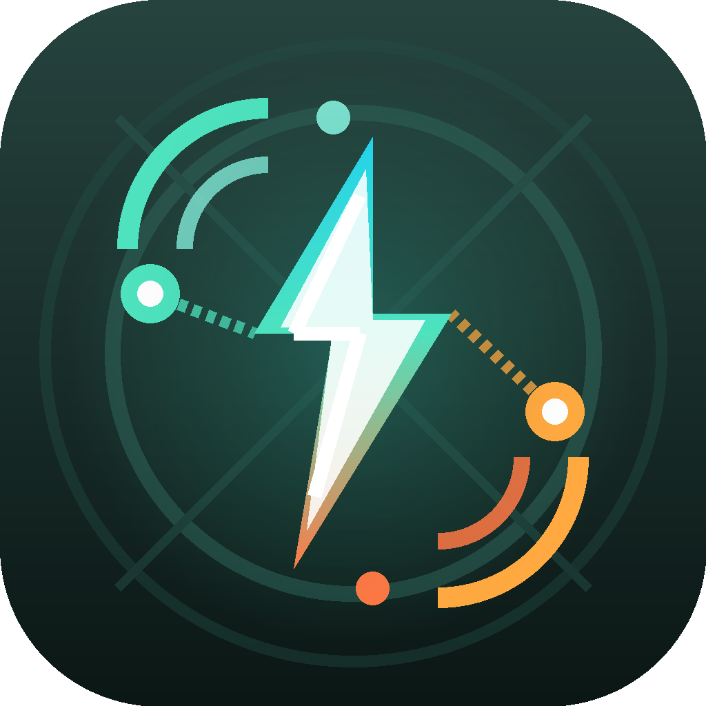
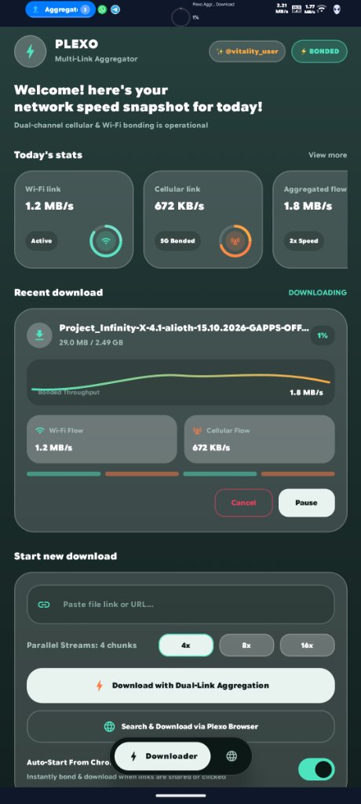
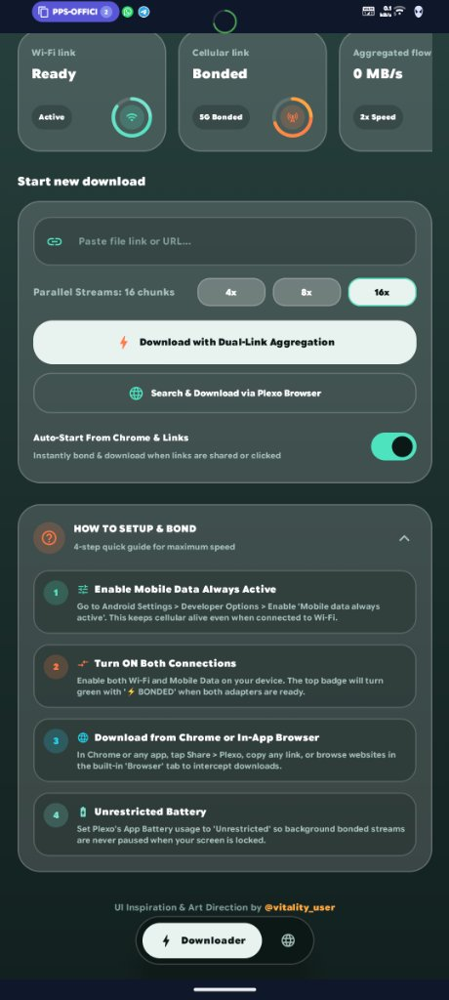

<div align="center">
  
  <h1>Plexo Android ⚡</h1>
  <p><b>Multi-Network Download Manager for Android (Wi-Fi + 5G Cellular Bonding)</b><br/><i>UI Design & Art Direction by <a href="https://github.com/vitalityuser">@vitalityuser</a></i></p>

  <p>
    <a href="https://github.com/VitalityUser/plexo-android/releases"></a>
    
    
    <a href="https://vitalityuser.github.io/plexo-android/"></a>
  </p>
</div>

> **Plexo Android** is a high-speed **multi-network download manager for Android** that combines **Wi-Fi and 5G/4G Cellular data simultaneously** into a single bonded download pipeline. By utilizing per-socket network interface binding and multi-stream parallel chunking, Plexo achieves up to **2x faster aggregated download speeds** than traditional single-pipe downloaders.

---

## 📱 Screenshots & Vitality Frosted Sage UI

<div align="center">
  <table>
    <tr>
      <td align="center" width="33%">
        <b>⚡ Real-Time Bonded Download</b><br/><br/>
        
      </td>
      <td align="center" width="33%">
        <b>🌐 Built-In Browser Sniffer</b><br/><br/>
        
      </td>
      <td align="center" width="33%">
        <b>🛠️ Quick Setup & Bonding Guide</b><br/><br/>
        
      </td>
    </tr>
  </table>
</div>

---

## 🔍 Why Choose a Multi-Network Download Manager?

Standard Android download managers (like 1DM, ADM, or Google Chrome) can only route data through one active network interface at a time. If you have both blazing-fast Wi-Fi and 5G Cellular available, one of them sits completely idle.

**Plexo Android eliminates this bottleneck.**

| Feature | Standard Android Downloaders | Plexo Android (Multi-Network) |
| :--- | :--- | :--- |
| **Network Aggregation** | ❌ Single network only (Wi-Fi OR Cellular) | ✅ **Simultaneous Wi-Fi + 5G/4G Bonding** |
| **Socket Binding** | ❌ Default OS routing | ✅ **Per-socket interface routing via ConnectivityManager** |
| **Download Speeds** | ⚠️ Bottlenecked by single connection | ⚡ **Up to 2x Faster Aggregated Bandwidth** |
| **Chrome Link Interception** | ✅ Supported | ✅ **Instant Auto-Catch via Share & Clipboard** |
| **In-App Browser** | ⚠️ Generic / Ad-heavy | 🌐 **Integrated Browser with 1-Tap Sniffing** |
| **User Interface** | ⚠️ Outdated legacy UI | 🌿 **Vitality Frosted Sage Glassmorphism UI** |
| **Privacy & Cost** | ❌ Closed source with ads & trackers | 🛡️ **100% Free & Open Source (No Ads)** |

---

## 🚀 Key Features

- **⚡ Simultaneous Wi-Fi & Cellular Bonding**:  
  Binds parallel download chunks across separate network interfaces simultaneously using Android's `ConnectivityManager.requestNetwork` and `OkHttpClient` socket factories.
- **🎯 Auto-Detect Downloads from Chrome & Any Browser**:  
  Tap **Share > Plexo** in Chrome or click direct download links (`.apk`, `.zip`, `.rar`, `.7z`, `.iso`, `.mp4`, `.bin`, `.exe`) to automatically intercept and accelerate downloads.
- **📋 Smart Clipboard Sniffer**:  
  Automatically detects copied file URLs on your clipboard when switching back to the app.
- **🌐 Dedicated In-App Plexo Browser**:  
  Built-in web browser equipped with automatic `DownloadListener` sniffing, bookmark chips, and instant redirection to real-time speedometers.
- **📊 3-Screen Frosted Sage Glassmorphic UI**:  
  Art-directed design inspired by `@vitality_user`:
  - **Home:** Speed snapshot, circular progress gauges, parallel chunk selector (4x, 8x, 16x).
  - **Statistic:** 7-day throughput bar chart with peak bonding highlights, live area waveform telemetry.
  - **Profile:** Bonding engine switches, developer credits, and preferences.
- **🛡️ Background Resiliency**:  
  Powered by an Android `ForegroundService` with WakeLock protection so your bonded downloads never stall when the screen turns off.
- **🔓 No Root Required**:  
  Works entirely in user space on standard Android 8.0 (API 26) through Android 15+.

---

## ⚡ How to Setup & Bond Dual Connections

1. **Enable Mobile Data Always Active**:
   - Open Android **Settings > Developer Options**.
   - Turn **ON** **"Mobile data always active"** *(keeps cellular connection alive in the background while Wi-Fi is connected)*.
2. **Turn On Both Connections**:
   - Turn on both **Wi-Fi** and **Mobile Data**. The status badge in Plexo will light up **`⚡ BONDED`**.
3. **Start Downloading**:
   - Share any link from Chrome to Plexo, paste a direct file URL, or search inside the built-in Plexo browser.
4. **Set Battery to Unrestricted**:
   - In App Info > Battery, choose **Unrestricted** to allow continuous multi-stream background downloads.

---

## 🛠️ Download & Installation

### Pre-Built APK Download
Get the latest official signed release directly:

[](https://github.com/VitalityUser/plexo-android/releases/download/v1.0.0/Plexo-Android-v1.0.0.apk)

Or browse all versions on the [Releases](https://github.com/VitalityUser/plexo-android/releases) page.

### Building from Source
```powershell
# Clone the repository
git clone https://github.com/vitalityuser/plexo-android.git
cd plexo-android

# Build Signed Release APK
./gradlew assembleRelease
```
The compiled APK will be at:
`app/build/outputs/apk/release/Plexo-Android-v1.0.0.apk`

---

## ❓ Frequently Asked Questions (FAQ)

### What is a multi-network download manager for Android?
A multi-network download manager is an application capable of using multiple internet connections (such as home Wi-Fi and 5G mobile data) at the exact same time. It divides a file into multiple parallel chunks and streams them through different network adapters simultaneously, combining their speeds.

### Does Plexo require root access?
No. Plexo Android uses official Android multi-network APIs (`ConnectivityManager.requestNetwork`) available in Android 8.0 and above. No root access or custom ROM is needed.

### Does combining Wi-Fi and Cellular use my mobile data plan?
Yes. The chunks routed through the cellular adapter will consume mobile data. Plexo allows you to monitor exactly how much data is flowing through Wi-Fi vs. Cellular in real-time.

---

## 👤 Author & Design
- **Developer & Maintainer**: [@vitalityuser](https://github.com/vitalityuser)
- **UI Design & Art Direction**: [@vitality_user](https://github.com/vitalityuser)
- **License**: MIT Open Source
